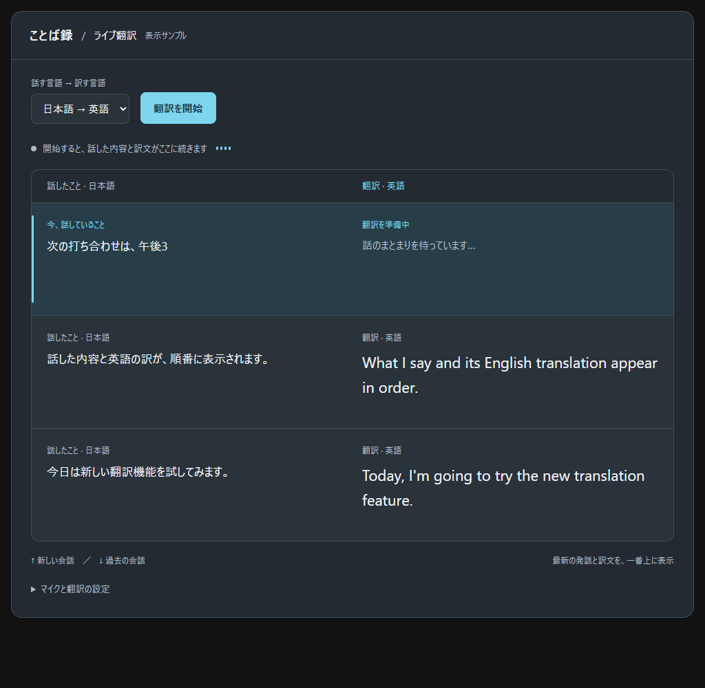

# ことば録：v0.3.0実装方針書

- 作成日：2026-10-17（日本時間）
- 対象：`nemotron-web`。`0.2.0` を基に、本書の内容を `0.3.0` として実装。
- 文書の状態：実装済み（2026-10-17、日本時間）。3章の画像は設計サンプル。実装・検証結果は11章。
- 合意した内容：対訳を並べるおすすめ案を採用し、新しい会話を上へ追加する。
- 前版：[v0.2.0実装方針書・実装結果](v0.2.0-implementation-plan.md)。本書に記載のない認識・補正・翻訳の仕様は現行実装を引き継ぐ。

## 1. 今回の決定

1. **技術に詳しくない人が、言語を選んで開始するだけで使える「ライブ翻訳」画面を追加する。**
2. **原文と訳文をペアにして表示し、最新の会話を一番上に置く。** PCでは左右、狭い画面では同じペアの中で原文・訳文を上下に並べる。
3. 新しい発話区間が始まったときだけ先頭に行を追加する。途中の認識文字、仮訳、最終訳は対応する同じ行を更新する。
4. 最新を見る位置を一定にし、これまでの会話は下へ積み重ねる。過去の会話を読んでいる間は、その表示位置を保つ。
5. **既存のリアルタイム翻訳と認識・補正・翻訳・保存の処理を共用する。** 新しい画面のために別の翻訳エンジンや並列録音を作らない。
6. 既存のリアルタイム翻訳画面は詳細確認用として残す。初めて使う人向けの画面では、モデル名・文末判定・補正差分を常時表示しない。
7. 表示は新しい順、コピー・ファイル保存は発話の時系列順にする。

## 2. 利用者と画面の役割

対象は「リアルタイム翻訳を使ってみたいが、モデルや音声認識の設定には詳しくない人」。画面の役割は、**今話している内容と、その訳文が続けて出ていることを直感的に伝えること**とする。

利用の流れは次のとおり。

1. 「話す言語 → 訳す言語」を選ぶ。
2. 「翻訳を開始」を押す。初回はブラウザのマイク許可に対応する。
3. 話した内容と訳文を一番上で確認する。
4. 「翻訳を終了」を押し、残りの訳文が出るまで待つ。
5. 必要に応じて会話をコピー・保存する。

「すべての言葉が発話と同時に翻訳される」という期待は作らない。原文は受信に合わせて表示し、訳文は話のまとまりと実際の生成に合わせて更新する。

## 3. 採用する画面



画像は合意した表示サンプルの参考図。収録中の画面や、実際の認識・翻訳速度を示すものではない。

```text
ことば録 / ライブ翻訳

話す言語 → 訳す言語
[ 日本語 → 英語 ▾ ]   [ 翻訳を終了 ]
● 聞き取り中 · そのまま話してください

話したこと · 日本語             翻訳 · 英語
────────────────────────────────────────────
今、話していること             訳文を更新中
次の打ち合わせは、午後3時…     The next meeting…
────────────────────────────────────────────
ひとつ前の発話                 対応する訳文
────────────────────────────────────────────
さらに前の発話                 対応する訳文

↑ 新しい会話 / ↓ 過去の会話
▸ マイクと翻訳の設定
```

### 3.1 常に見せるもの

- 翻訳方向：日本語→英語、英語→日本語。言語は日本語表記で案内する。
- 開始・終了の主操作。
- マイクの稼働状態と、実際の入力音量に反応する小さな表示。
- 原文・訳文のペア。訳文を原文より少し大きくする。
- 最新行の控えめな背景色と左端の目印。色と状態ラベルを併用する。
- 操作に必要なエラー・待機の案内。

ページ名や案内にASR、Ollama、revisionなどの内部用語を使わない。装飾よりも文字の読みやすさと、今見る場所の分かりやすさを優先する。既存の落ち着いた配色と青系のアクセントを踏襲する。

### 3.2 必要なときに開くもの

「マイクと翻訳の設定」は初期状態で閉じ、マイク、訳すタイミング、日本語の誤変換補正ON/OFFを配置する。

| 利用者向けの表記 | 既存設定との対応 |
|---|---|
| 早め | `speed`／速度重視 |
| 標準 | `balanced`／バランス重視 |
| 文脈を優先 | `context`／文脈重視 |

新規利用時は既存どおり標準、日本語補正ONを使い、保存済みの設定があれば引き継ぐ。英語入力では日本語補正を適用しない。方向・マイク・翻訳設定は開始前に変更し、準備中・録音中・残処理中は変更しない。

モデル名、文末判定の方式、補正前後・差分、翻訳入力の由来、区切り理由、モデル比較は詳細画面で確認する。これらの情報をデータから削除することはない。コピー・保存は会話がある停止後に表示する。

## 4. 会話の並べ方と更新

### 4.1 行の単位と順序

- 行の単位は既存処理が管理する翻訳区間とする。話者や一回の息継ぎを推定して別の区間を作らない。
- 新しい区間は最初に認識した時点で先頭へ追加する。原文・訳文の更新だけでは行を追加しない。
- 内部データは発話順に管理し、利用者向け画面だけ新しい順へ投影する。元配列を `reverse()` や `sort()` で破壊的に変更しない。
- 並び順は区間の発生順で固定する。訳文の到着時刻、完了時刻、再翻訳時刻で並べ替えない。
- 最新行より古い区間の訳文が遅れて届いた場合、その古い行の訳文だけを更新する。
- Reactのキーはセッションと区間の安定したIDを使う。配列添字や訳文そのものをキーにしない。

### 4.2 認識中の文字と区間の引き継ぎ

音声認識の途中文字は、対応する受信中の行に表示する。翻訳区間IDがまだない段階では、一つの認識中の表示枠を使う。IDが確定したら対応する区間へ引き継ぎ、同じ発話を二重に表示しない。まだ文字を受け取っていない無音の状態で空行を増やさない。

ASRの確定原文と翻訳区間は必ずしも一対一ではない。既存の区間組立結果を正とし、UI側で句点や無音から独自の分割を行わない。区間の引き継ぎ時に先行する区間の訳文へ別の原文を重ねない。

実装開始時に、途中文字・ASR確定・`translation.segment` が届く順序を確認する。既存イベントで対応を確定できない場合は、その対応を識別するために必要な最小限のイベント情報を追加する。文字列の類似度だけで対応を推測しない。この変更が必要になった場合は、互換性と理由を実装結果へ記録する。

### 4.3 仮訳と最終訳

- 訳文は実際に受け取った差分を順次表示する。見かけの速さを演出するための文字送りは行わない。
- 仮訳は「訳文を更新中」と表示し、続きによって修正されることを短い案内で伝える。
- 同じ区間の最終訳は同じ行へ反映する。古いrevisionの結果を新しい原文へ適用しない。
- 日本語補正がある場合も、主画面の「話したこと」には認識原文を表示する。補正後の文章と実際の翻訳入力は詳細画面に残す。
- 最新行の強調と、翻訳処理中の行の状態は区別する。古い行の翻訳開始を理由に、その行を最新扱いにしない。

## 5. 表示位置と読みやすさ

### 5.1 最新を見ているとき

先頭を見ている間は、新しい行を先頭に表示する。前の会話は下へ送り、最新の原文・訳文を見る位置を一定にする。操作欄と列見出しは、製品画面内で邪魔にならない範囲で見える状態を保つ。

最新行には数行分の余白を確保し、原文・訳文が伸びるたびに履歴全体が小刻みに動くことを抑える。内容が長い場合は行を自然に広げ、省略や固定高によって文字を隠さない。

### 5.2 過去の会話を読んでいるとき

- 利用者が下へスクロールして履歴を読んだら、先頭へ自動で戻さない。
- 新しい行の追加と、読み位置より上にある行の高さ変更の両方で、見ていた行と画面内の位置を保つ。
- 初期案は「先頭から24px以内」を最新追従、それより下を履歴閲覧として判定する。実装時に操作感を確認して調整する。
- 履歴閲覧中に新しい区間が来たら「新しい会話 ○件 · 最新へ戻る」を表示する。件数は新しい区間だけを数え、訳文の差分では増やさない。
- 「最新へ戻る」を押すか先頭へ戻ったら、件数をリセットして最新追従を再開する。
- 行IDと表示位置を基準にスクロールを補正する。ブラウザの自動補正とアプリの補正が重複して画面を動かさないようにする。

PCでは原文・訳文を同じ行の左右に並べる。狭い画面では原文、その直下に訳文を表示し、一つのペアを保つ。横スクロールを発生させない。文字サイズの調整を用意し、キーボード操作と文字拡大にも対応する。状態変化は読み上げ可能にするが、逐次更新の全文を毎回読み上げない。動きを減らす設定を尊重する。

## 6. 状態と操作の表記

| 状態 | 主な案内 | 主操作・動作 |
|---|---|---|
| 開始前・会話なし | 「開始すると、話した内容と訳文が表示されます」 | 翻訳を開始 |
| 準備中 | 「翻訳を準備しています」 | 準備を中止。準備完了前に聞き取り中と表示しない |
| 聞き取り中 | 「聞き取り中 · そのまま話してください」 | 翻訳を終了。入力音量に反応する表示 |
| 発話の途中 | 「今、話していること」／「話のまとまりを待っています」 | 同じ行の原文を更新 |
| 訳文の生成中・仮訳 | 「訳文を更新中」 | 同じ行の訳文を更新 |
| 終了直後 | 「聞き取りを停止しました。残りを翻訳しています」 | 新規開始は不可。マイクは解放する |
| 残処理の完了 | 「翻訳が完了しました。会話はそのまま残ります」 | 再び開始、コピー、保存 |
| 残処理の中断 | 「未完了の訳文があります」 | 必要な場合だけ残りの翻訳を中断できる。原文を保持 |
| 一部の翻訳失敗 | 対象行に「この文を翻訳できませんでした」 | 原文・途中の訳文を保持し、停止後に再試行 |
| 保存容量不足 | 「ブラウザに保存できません。会話をファイルに保存してください」 | コピー・ファイル保存を案内 |

マイク未許可・マイク未接続・接続切断では、原因と次に行う操作を短く伝える。接続切断時も表示済みの会話を残す。入力がない状態、話のまとまり待ち、翻訳待ちを一律に「翻訳中」と表示しない。

準備中・録音中・残処理中・再試行中は、重複開始、画面の切替、セッションの消去を防ぐ。利用者向け画面の終了は聞き取りも停止する操作とし、既存の「翻訳だけ中断」は詳細画面に残す。残処理を中断する場合は、未完了の行を完了扱いにしない。

停止後の再開では、既存どおり会話へ追記し、新しいセッション内の区間を先頭に置く。会話を空にする操作は開始操作と分ける。

## 7. 入口・共通処理・データ互換性

### 7.1 入口

- 新しい利用者向けの入口は「ライブ翻訳」、直接開くURLは `/#live` とする。
- 既存の `/#translate` は詳細画面として維持し、通常の文字起こし・Whisper比較の入口も維持する。
- ライブ翻訳では、文字起こし用のサイドバー設定・履歴・長い技術説明を常時表示せず、開始と会話を中心に配置する。
- ライブ翻訳から詳細画面を開けるようにする。初版では切替可能なタイミングを停止・残処理完了後に限定し、両画面で同じ会話を確認できるようにする。

### 7.2 処理の共有

現行の `src/Translation.tsx` は、イベント処理、録音状態、再試行、保存と表示を一つのコンポーネントで持つ。これを共通のコントローラまたはフックと、画面の描画に分ける。

| 共用する処理 | 利用者向け画面で変える表示 |
|---|---|
| `MicrophoneCapture` と `/ws/translate` | 開始・終了の表記、音量表示 |
| 原文・補正・訳文・revisionの反映 | 最新が上の対訳、簡潔な状態ラベル |
| 翻訳方向・マイク・区切り・補正設定 | 分かりやすい表記と折りたたみ |
| 準備・停止・残処理・中断・再試行 | 状態別の案内と操作の出し分け |
| ブラウザ保存・復元・コピー・ファイル保存 | 停止後を中心にした操作配置 |
| 処理中の排他 | 他画面・他処理との重複開始の防止 |

一つの会話に対する状態と保存処理の所有者は一つにする。画面を二つマウントした結果、マイク、WebSocket、保存処理が二重に動かない構成にする。表示切替によって会話を初期化しない。

Nemotron、共通Gemma、文末判定、区切り上限、補正の検証、翻訳キュー、停止後の待機上限は現行仕様を維持する。表示を上向きにしたことを理由に、翻訳処理自体を新しい区間から優先することはない。UI変更に速度向上や認識精度向上を含めない。

### 7.3 保存と復元

- `kotoba.translation` の既存データを読み取れる状態を維持する。詳細画面と利用者向け画面で、別の会話コピーを保存しない。
- 保存する配列とコピー・Markdown出力は古い発話から新しい発話への時系列順とする。新しい順の表示配列を保存・文脈生成へ流用しない。
- 原文、補正後、翻訳入力、訳文、未完了・仮訳・失敗の区別、既存のモデル情報・区切り理由を保持する。
- 復元時は既存の配列順を発話順として読み、新しい画面では逆順に表示する。古い区間の再試行で並び順を変えない。
- 未完了の旧データは中断として復元し、勝手にマイク開始や再翻訳をしない。
- 音声の永続保存は追加しない。既存の保存容量不足への案内を維持する。

## 8. 今回の対象外

訳文フォーカス案の追加、話者分離、双方向の自動言語切替、読み上げ、単語登録、音声モデル・翻訳モデルの変更、翻訳速度を上げるための処理変更、クラウド化、別端末への公開は含めない。

このバージョンでは「既存と同じ翻訳機能を、利用者が直感的に使える別の画面で提供する」ことに集中する。

## 9. 変更するファイルの目安と実装順序

| ファイル | 変更の目安 |
|---|---|
| `src/App.tsx` | `#live` の入口、利用者向けレイアウト、画面切替、共通状態の所有と排他 |
| `src/useLiveTranslation.ts`（新規案） | 現行翻訳のイベント・状態・設定・録音操作・復元・保存処理を共通化 |
| `src/translation-types.ts`（新規案） | 原文・補正・訳文の型など、両画面の共通定義 |
| `src/LiveTranslation.tsx`（新規案） | 利用者向けの対訳画面、最新順、表示位置の保持、状態別の操作 |
| `src/Translation.tsx` | 詳細画面として共通処理を利用。補正差分とモデル比較を維持 |
| `src/styles.css` / `tokens.css` | 利用者向け画面の文字サイズ、強調、狭い画面、フォーカス、動きの制御 |
| `test/translation.spec.mjs` と追加のブラウザ試験 | 既存画面の回帰と、新しい順・途中更新・読み位置・保存の検証 |
| `README.md` / `package.json` / `package-lock.json` | 実装完了時に使い方・入口・版番号を更新 |

ファイル名は実装の目安。画面を増やすためにサーバー側の翻訳実装を複製しない。

1. **現行挙動の確認と共通化**：途中文字と区間イベントの対応、停止・残処理・再試行・保存を確認し、詳細画面の機能を保って共通処理を取り出す。
2. **ライブ翻訳画面の追加**：入口、簡潔な操作、対訳、最新順、途中文字・仮訳・最終訳の同じ行への反映を実装する。
3. **表示位置と保存の整備**：履歴閲覧中の位置保持、最新へ戻る、時系列順のコピー・保存、両画面での会話共有を実装する。
4. **検証と文書更新**：日英両方向、エラーと残処理、画面幅、長い会話を確認し、本書へ結果を追記する。製品の版番号は実装完了時に `0.3.0` へ更新する。

## 10. 完了条件と検証

### 10.1 利用者向けの完了条件

- 技術設定を開かず、方向選択と開始だけで利用できる。
- 新しい原文・訳文のペアが先頭に追加され、今見る場所が分かる。
- 一つの区間に文字や訳文が追加されても行が増殖しない。
- 訳文の到着順が逆転しても、原文と訳文の対応と発話順が崩れない。
- 履歴を読んでいるときに画面を先頭へ戻されず、明示操作で最新へ戻れる。
- 終了後はマイクが解放され、残処理・完了・未完了を区別できる。
- コピー・保存した会話は古い発話から順に読める。
- 既存の詳細翻訳、通常文字起こし・補正・整形・要約、比較画面を利用できる。

### 10.2 必須の検証

| 確認 | 合格条件 |
|---|---|
| 3区間以上の発話 | 発生順がA→B→Cなら表示はC→B→A、出力はA→B→C |
| 途中文字→区間組立→仮訳→最終訳 | 同じ原文が二重表示されず、対応行の訳文が更新される |
| 古い応答と遅延 | 古いrevisionは破棄。古い区間の遅い完了や再試行で先頭へ移動しない |
| 連続した差分更新 | 同一区間の更新ごとに会話を追加・並べ替えしない |
| 履歴閲覧中の更新 | 先頭追加と上側の行の伸長後も、表示基準の行の位置を保つ。自動試験の目安は差分2px以内 |
| 最新へ戻る | 新規区間数だけが加算され、戻ったら件数が消えて最新追従が再開する |
| 方向と設定 | 日英両方向が既存処理と同じ設定で動き、処理中は変更できない |
| 準備中止・終了・残処理中断・接続切断 | 重複開始せず、マイクを解放し、原文と未完了状態を保持する |
| マイク未許可・未接続・翻訳失敗 | 次に行う操作が分かり、停止後に再試行できる |
| 両画面と復元 | 停止後の切替で同じ会話が見え、旧データも消えない。保存が競合しない |
| コピー・保存 | 新しい順に表示中でも時系列順。補正・仮訳・失敗などの情報を保持する |
| レイアウトと操作 | 320/375/768/1440px、長文、文字拡大、キーボード操作で文字や主操作が欠けない |
| 継続利用 | 15分相当の会話イベントで原文の欠落・重複がなく、履歴閲覧と最新追従を切り替えられる |

順序・イベント・表示位置の検証は再現可能な入力によるブラウザ試験を中心にする。既存の仮想マイクによる日英両方向の通し確認も行い、サンプル表示の動作確認と実際の認識・翻訳を区別して記録する。

実装完了時に `npm test`、`npm run build`、該当するPlaywright試験を実行する。長時間の確認はUIの保持・操作性の検証とし、新たな認識精度・翻訳品質の評価結果として扱わない。

## 11. 実装結果（2026-10-17、日本時間）

### 11.1 実装した範囲

- `/#live` にライブ翻訳を追加した。方向選択と開始・終了、実入力音量に反応する表示、原文・訳文の対、最新行の強調、文字サイズ、折りたたみ設定を実装した。PCは左右、狭い画面は原文・訳文を上下に置く。
- `src/useLiveTranslation.ts` を `App` で一度だけ呼び、録音、WebSocket、区間・revision、停止・残処理、再試行、保存を共通化した。`Translation.tsx` は詳細画面としてこの状態を描画する。区間型は `translation-types.ts` へ分離した。
- `LiveTranslation.tsx` は内部の時系列配列のコピーを逆順へ投影する。安定したセッションID・区間IDで更新し、古い結果や古い区間の再試行で順序を変えない。日本語補正があっても主画面には認識原文を表示する。
- 履歴の閲覧位置は行IDとスクロール枠内の位置で保持する。`useLayoutEffect` と `ResizeObserver` で先頭追加と上側の伸長へ対応し、ブラウザの自動補正は `overflow-anchor: none` で停止した。24px以内は先頭追従とし、新規区間だけを件数へ加算する。
- 準備中・録音中・残処理中・再試行中の設定・画面切替・消去を禁止した。ハッシュの直接変更とホームのリンクも排他対象とした。停止後の再開は会話へ追記し、消去は別操作にした。
- マイク準備中止、マイク未許可・未接続、残処理中断、翻訳失敗と停止後の再試行、接続切断、保存容量不足を案内する。切断時に未確定の途中文字があれば中断原文として保持する。失敗した再試行で既存の途中訳を消さない。
- `kotoba.translation` は両画面で同じ保存処理を使う。旧データの配列順・追加メタデータを保持し、未完了区間は中断として復元する。コピー・Markdownも時系列順とし、補正・仮訳・失敗などの情報を残す。
- 読み上げ用には全件数・完了件数・未完了件数と操作状態だけを通知し、ストリーム中の本文を毎回読み上げない。フォーカス表示、キーボード操作、動きを減らす設定に対応した。
- `package.json`、ロックファイル、ヘルス応答を `0.3.0` へ更新した。モデル、翻訳キュー、区切りロジック、補正検証、待機上限は既存どおり。

### 11.2 途中文字と区間の対応・互換性

既存ブリッジはASR確定イベントを受けると、クライアントへ確定通知を転送する前に区間を組み立てていた。一区間が複数のASR確定にまたがる場合や、一つの確定原文が複数区間に分かれる場合があり、文字列の照合だけでは途中文字の所属を確定できなかった。

そこで `/ws/translate` に限り、既存の `conversation.item.input_audio_transcription.delta` に `translationSegmentId` を追加した。値はサーバーの区間組立処理が現在管理するIDで、まだ区間がない場合は `null` とする。確定時はASR確定イベントを先に転送して途中文字を退かし、その後に既存の区間組立を実行する。新しい翻訳用イベントや別の翻訳エンジンは追加していない。

ライブ画面はそのIDが受信中の区間に一致すれば同じ行に途中文字を表示し、IDがない場合は一つの受信枠を使う。区間確定後に届く別の原文を、先行区間の訳文へ重ねない。句点・無音・文字列類似度からUIで独自の区切りは作らない。

既存クライアントは追加フィールドを無視できる。確定通知の順序変更は、詳細画面でも途中文字を先に消す効果となる。`/ws/transcribe` の通常文字起こし・補正イベント順は変更していない。ブリッジの自動試験で、`null → 区間ID` の対応と、確定通知が区間更新より先に届くことを検証した。

### 11.3 検証結果

Windows、Node.js 24.14.0、ローカルEdge、起動済みNemotronと共通Gemmaを使用した。検証用Webサーバーをポート3211で別に起動し、起動済みの通常アプリには停止操作をしていない。

| 検証 | 結果 |
|---|---|
| `npm test` | 63件成功。区間組立、補正、翻訳、ブリッジ、比較、排他の回帰を含む |
| `npm run build` | TypeScriptとViteのビルド成功 |
| Playwright全体 | 28件中26件成功・2件スキップ（51.3秒）。ライブ画面・既存画面の回帰と実翻訳3件を含む。切断時の英語の単語間隔保持を追加した後、該当シナリオも単独で再確認して成功 |
| 順序・対応 | A→B→CをC→B→Aで表示し、コピー・Markdown・保存データはA→B→C。仮訳・最終訳を同じ行で更新し、逆順で届く完了と古いrevisionを検証 |
| 履歴位置 | 先頭追加、上側の訳文伸長、文字サイズ変更後の基準行の位置差が2px以内。差分更新で新規件数が増えず、最新へ戻る操作で解除 |
| 15分相当のUIイベント | 5秒間隔180区間を加速投入し、連続差分・履歴閲覧・最新追従を検証。追加2区間を含む182件の保存、全180原文の一致、IDの一意性を確認 |
| 状態とエラー | 準備中止、マイク未許可・未接続、終了直後のマイク解放、残処理中断、切断時の途中文字保持、途中訳を保持した翻訳失敗・再試行、処理中の排他、容量不足を確認 |
| 共有・復元 | 停止後のライブ・詳細切替で同じ会話を保持。旧仮訳は中断として復元し、原文・補正差分・モデル情報を維持。別セッションの区間IDが同じでも追記できる |
| 画面・操作 | 320 / 375 / 768 / 1440px、長文・改行なしの文字列、大きな文字、ルート文字サイズ200%、キーボードでの設定開閉で横方向のはみ出しなし |
| 実サービスの仮想マイク | 日本語音声8.65秒と英語音声10.27秒をそれぞれ最後まで入力し、日→英・英→日の最終訳、停止後の残処理完了、サーバーの録音・翻訳ロック解放を確認。既存詳細画面での実翻訳試験も成功 |

実サービスに接続した製品画面の記録（入力は合成音声）：

- [日本語→英語](images/v0.3.0-live-implemented-ja.png)
- [英語→日本語](images/v0.3.0-live-implemented-en.png)

再現する場合はアプリ起動後に実行する。仮想マイク音声は `scripts/create-test-audio.ps1` で生成できる。日本語・英語のWindows音声を使用する。

```powershell
npm test
npm run build
$env:KOTOBA_TEST_URL='http://127.0.0.1:3210' # 検証専用ポートなら変更
$env:KOTOBA_TRANSLATION_LIVE='1'
npx playwright test
```

`KOTOBA_TRANSLATION_LIVE` を指定しない通常のブラウザ試験では、実Gemmaを使う3件はスキップする。今回の実行ではそれらも実施した。通常文字起こしとWhisperの実サービス試験2件は別の `KOTOBA_LIVE` スイッチが必要で、今回はスキップした。通常文字起こし・補正・整形・要約・Whisper比較のモック回帰試験は成功した。

### 11.4 制約と未検証事項

15分相当の確認は、180区間を加速投入する表示・保存・読み位置の試験であり、15分間の実時間ASR推論・翻訳品質・メモリ測定ではない。実サービスへの通し確認は短い合成音声で行った。実マイク、騒音、話者差、15分間の実音声連続運転による品質評価は今回追加していない。認識・翻訳精度の向上を示す結果として扱わない。

読み位置は行IDと行の画面内位置で保持する。履歴は全件を描画しており、数万区間規模の仮想スクロールは実装していない。OSの読み上げソフトによる手動確認は未実施。状態通知用のDOMを実装し、キーボード操作をブラウザ試験で確認した。

起動済みの旧版を使っている場合は、アプリを再起動しブラウザを再読み込みする。サーバー側の途中文字対応フィールドも再起動後に有効になる。
