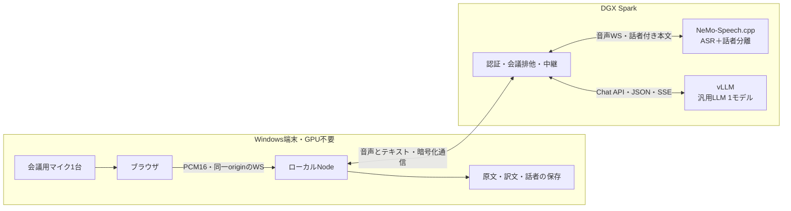

# ことば録：v1.0.0 技術設計案 — DGX Sparkでの推論

- 更新日：2026-10-17（日本時間）
- 状態：資料・現行コードに基づく設計。Sparkへの接続・配備・性能測定は未実施。
- 機能方針：[v1.0.0実装方針書](v1.0.0-implementation-plan.md)。配置・接続・運用の具体案は本書を優先する。

## 1. 確認済みの利用条件と推奨構成

利用条件は、3〜8人の会議、会議用マイク1台、GPUなしのWindows端末も利用、同時1会議。重なった発話の各人の全文認識は必須にせず、当面は文字起こし・翻訳のみ保存する。Spark上のLLMモデルは未定。

**標準構成では、ASR・話者分離・LLMをDGX Sparkへ集約する。端末はブラウザとローカルNodeサーバーを動かし、録音・画面・保存を担当する。** 「ローカルLLM」はクラウドAPIを使わず、利用者のDGX Sparkで推論する意味で扱う。

| 配置 | コンポーネント | 役割 |
|---|---|---|
| Windows端末 | ブラウザ | マイク取得、PCM16送信、原文・訳文・話者の表示 |
| Windows端末 | 既存Nodeサーバー `127.0.0.1:3210` | 設定、会議制御、話者別の文区切り、補正・翻訳キュー、通信中継、テキスト保存 |
| DGX Spark | 小規模な共通ゲートウェイ | 端末の認証、会議の排他、ASRのWS中継、vLLMのSSE中継、能力・状態の公開 |
| DGX Spark | NeMo-Speech.cpp | Nemotron 3.5 ASRとNemotron-3-Diarizationを同一プロセスで利用 |
| DGX Spark | vLLM | 共通の汎用LLMを1モデル常駐させ、補正・翻訳・文末判定・整形・要約を担当 |

端末内Ollama＋端末内ASRはGPU搭載PC向けの任意構成として維持できるが、GPUなし端末での自動代替先にはしない。Sparkへ接続できないときは開始前に知らせ、録音中にモデルや処理場所を自動変更しない。

ブラウザは引き続きlocalhostから開く。マイク取得にはsecure contextが必要で、localhostは対象になる。SparkのHTTPページを直接開く構成へ変えるとHTTPS等の検討も必要になるため、v1.0では既存の入口を維持する。[MDN getUserMedia](https://developer.mozilla.org/en-US/docs/Web/API/MediaDevices/getUserMedia)

## 2. Spark上のランタイムと導入方法

DGX SparkはArm64 CPUと128 GBのCPU/GPU共有メモリを持つ。Windows x64向け実行ファイルをコピーして実行する構成ではない。[NVIDIAハードウェア仕様](https://docs.nvidia.com/dgx/dgx-spark/hardware.html)

- 音声処理：NeMo-Speech.cppのLinux aarch64 CUDA版を第一候補とする。v0.2.0にはaarch64のCUDA 12/13向け配布物があるが、**対象SparkのドライバーとGB10で正しく動くことは実機PoCの条件**。起動できてもCPUへ落ちていないことをログで確認する。[公式リリース](https://github.com/NVIDIA/NeMo-Speech.cpp/releases/tag/v0.2.0)
- 既成配布物で動かない場合：対応するCUDA環境でArm64向けにビルドし、コミット・コンパイラ・ビルドオプション・成果物ハッシュを固定する。x86エミュレーションを標準運用にしない。
- vLLM：Spark向けの公式レシピでモデルと整合するArm64対応コンテナを選び、検証後にタグとdigestを固定する。`latest` の自動追従はしない。[NVIDIA Spark vLLM手順](https://build.nvidia.com/spark/vllm/instructions)
- ASRとvLLMは別プロセスにし、モデルはそれぞれ一度だけロードする。音声はsystemd等、vLLMはコンテナ、ゲートウェイは独立サービスとして状態を分ける。具体的な管理方式は既存Spark環境に合わせる。
- 起動順は音声・LLMのロードとウォームアップ→ゲートウェイ準備完了。端末アプリからSparkのサービスを勝手に起動・更新・再起動しない。

モデルは `nemotron-3.5` と `nemotron-3-diarization` の名前だけでなく、配布元・リビジョン・量子化・ハッシュを配備記録に保存する。端末側 `setup:asr` は標準構成では不要にし、Windows起動スクリプトも遠隔利用時にローカルASRやOllamaを導入・起動しない。

## 3. 接続・ポート・認証

### 3.1 APIを分け、設定画面から独立して確認する

ユーザー指定の `http://{IPアドレス}:8001/v1` というLLMの起点は利用できる。以下は新規配備時の論理的なポート案であり、実際のIP・ホスト名・認証情報は未定。

| API・サービス | 起点の例 | 用途 |
|---|---|---|
| 端末アプリ | `http://127.0.0.1:3210` | ブラウザのアクセス先 |
| Sparkのゲートウェイ | `https://{Spark名}:8001` | 暗号化・認証・排他を持つ入口 |
| LLM設定 | `https://{Spark名}:8001/v1` | `/models`、`/chat/completions` |
| 音声設定 | `https://{Spark名}:8001/speech` | `/ready`、`/v1/models`、`/v1/audio/transcriptions/realtime` |
| 会議制御 | `https://{Spark名}:8001/kotoba/v1` | 利用権の取得・更新・解放 |
| vLLM内部 | Spark内の `127.0.0.1:8000` | ゲートウェイからのみ到達 |
| 音声処理内部 | Spark内の `127.0.0.1:8081` | ゲートウェイからのみ到達 |

HTTPSを使う場合は端末Nodeが信頼できる証明書を用意し、検証の無効化で通さない。最初のPoCではSSH転送も選べる。その場合は端末の転送ポートを起点にし、通信先表示には実際のSparkを併記する。APIキーを使うHTTP平文と、HTTPS/SSH転送の違いを設定値として明確にする。

ゲートウェイを8001に置く案は、内部vLLMを別ポートにする配備案。既存のvLLMがすでに8001を使用する場合は無断で置き換えず、ゲートウェイ側ポートを変える。

### 3.2 ブラウザへ接続情報を渡さない

ブラウザ→端末Nodeは既存の同一origin通信とし、Node→SparkだけにAPIキーと会議利用権を付ける。ブラウザのCORS設定を広げてSparkへ直接接続する方式は採らない。音声WSの認証情報はNodeのWebSocket接続ヘッダーへ入れ、クエリ文字列には置かない。

LLM・音声接続のキーは端末サーバー所有の非公開設定へ保存する。モデル配布用HFトークンはSparkの導入用途に限定し、端末へ配布しない。認証済みのクライアントから必要なAPIだけを中継し、vLLMの管理系や内部通信ポートは入口に出さない。vLLMのAPIキーだけですべてのルートが保護されるとは扱わない。[vLLM公式セキュリティ説明](https://docs.vllm.ai/en/latest/usage/security/)

現行 `server/app.mjs` は音声WSを `new URL('/v1/audio/...', asrUrl)` で作るため、`/speech` のようなパス接頭辞が消える。v1.0では専用の音声接続処理にまとめ、HTTPとWSの両方で起点のパスを保持し、HTTP→WS、HTTPS→WSSへ正しく変換する。認証・切断・制限もこの処理へ集約する。

中継はWSのUpgradeとSSEの逐次転送に対応させ、SSEの応答バッファリングを無効にする。接続待ち・無通信・要求全体のタイムアウトを区別し、端末からの中止を上流へ伝える。ゲートウェイで全文が完成するまでためてから送る構成は、ライブ表示の遅延要因になる。

## 4. 同時1会議を端末間でも保証する

現行の `activeRecordings` / `activeTranslations` は端末Nodeごとの排他であり、異なる端末間では共有されない。vLLMの `--max-num-seqs 1` は処理中の系列数の制限で、会議の利用権にはならない。

Sparkゲートウェイに単一の利用権を持たせる。以下のパス・ヘッダーは新規アプリ仕様案で、NeMo/vLLM標準APIではない。

| 操作 | 仕様案 |
|---|---|
| 取得 `POST /kotoba/v1/leases` | 端末ID、用途 `meeting / test / retry / document` を指定。使用中は409。成功時に推測困難なtokenと期限を返す |
| 更新 `POST /kotoba/v1/leases/{id}/heartbeat` | 15秒間隔、失効60秒を初期案。端末Nodeが実施し、背景タブのタイマーに依存させない |
| 推論要求 | `X-Kotoba-Lease` で利用権を確認。ASR接続・LLM生成とも、所有端末・用途と照合する |
| 解放 `DELETE /kotoba/v1/leases/{id}` | 録音停止だけで解放せず、ASR末尾と翻訳キューの完了・中止を待つ |
| 失効 | 古い上流WSとLLM要求を中断・終了処理してから次の端末へ渡す。前の要求が終わらないときに重ねて利用開始させない |

ゲートウェイは単一プロセスを前提にする。再起動時は古いWSを切り、旧tokenを無効化する。端末側にも既存排他を残す。録音外の接続テスト・再翻訳・要約も生成を伴うなら利用権を取り、別端末の会議へ負荷を混ぜない。単なる設定閲覧やモデル一覧取得は生成せずに行える。

## 5. 音声・話者付き結果の仕様

### 5.1 会議用マイクと音声転送

初版は会議用マイク1台のモノラルPCM16入力とし、Teams/Zoomのシステム音声取得、複数マイクの同期、マイクごとの人物識別は対象外。

現行どおり実際のAudioContextレートを送信し、Spark側で一度だけ16 kHzへ変換してASRと話者分離へ渡す。48 kHzのモノラルPCM16は約96 kB/s（0.768 Mbps）、16 kHzなら約32 kB/s（0.256 Mbps）。帯域よりも、無線の瞬断・遅延変動と送信キューの詰まりを優先して評価する。初期PoCは有線LANで行う。

ブラウザの現行取得条件はAEC・雑音抑制・AGCがすべてON。会議用マイク側にもDSPがある場合は、重複処理で小さな相づちや声質に影響しないか比較する。「会議用マイク」と「ブラウザ標準」の入力プリセットを案とし、端末の実際のtrack設定を記録して評価する。全機種で同じ効果を保証しない。

通常のPCM送信は約20〜100 ms程度のまとまりを目安とし、入力レートによって変わる既存2048サンプルの送信も評価する。通信キューはバイト数に加え「未送信何秒分か」を監視し、上限超過を知らせる。PCMを黙って捨てて、その後の時刻をずらす処理は行わない。

長時間PoCはまず60分とする。NeMoの累積アップロード制限も設定し、入力8〜96 kHzで60分が通るか確認する（既定512 MiBでは96 kHz・60分のPCM16を収容できない）。上流の `--max-upload-mb 1024` を初期候補にし、WS単一フレームのサイズ制限とは分けて検証する。60分超の保証は別途耐久試験後に記載する。

### 5.2 会議の話者状態

第一案はNeMoの同一セッションのASR＋話者分離で、確定イベントの `words[]` を使う。8人を扱っても8本のマイクや8本のASRを立てる構成ではない。複数話者ASRのマスク方式へ進む場合は話者ごとのASR状態が増え、負荷の前提が変わる。

未確定本文は先に表示し、話者は判定待ち。確定後に同じ話者の連続区間へ分け、話者交代を文の強制区切りとする。標準WSで逐次の話者修正や同時発話の活動情報が得られるとは仮定しない。[NeMo-Speech.cpp API](https://raw.githubusercontent.com/NVIDIA/NeMo-Speech.cpp/v0.2.0/docs/api.md)

会議を表す `meetingId` と、上流の話者キャッシュの寿命を表す `sessionId` を分ける。接続が切れた後に同じ会議記録を開き続ける場合でも新しいsessionIdを付け、「接続が途切れた区間」を残す。別セッションの話者1を同じ人物に自動統合しない。話者不明や本文・単語の対応失敗でも原文を保持する。

## 6. LLM候補・選定・接続互換性

### 6.1 小型モデルから比較する

候補は速度や品質の順位を保証するものではない。モデルを未実測のまま固定せず、次を同一の会議データで比較する。

| 候補 | 比較する理由 | 確認する点 |
|---|---|---|
| `google/gemma-4-E4B` | 現行Gemma系の補正・翻訳との比較基準にしやすい | Spark上のvLLM対応、chat template、日本語・JSON。E4Bの名前から全重み量を4Bと計算しない |
| `Qwen/Qwen3.5-9B` | 別系列の汎用候補。公式にvLLM利用方法がある | 非思考モード、JSON Schema、Arm64/Blackwellの対応、短い翻訳の追従性 |

候補の一次情報：[Gemma 4 E4B](https://huggingface.co/google/gemma-4-E4B)、[Qwen3.5 9B](https://huggingface.co/Qwen/Qwen3.5-9B)。vLLMのGemma実行方法は [公式レシピ](https://docs.vllm.ai/projects/recipes/en/stable/Google/Gemma4.html)を参照。Ollamaの `gemma4:latest` 等の別名を、そのままvLLMモデルIDとして使わない。

初期比較は各モデルで安定する精度形式を使用し、結果に重みリビジョン・dtype・量子化を記録する。品質差と量子化差を混同しない。大型モデルやNVFP4への変更は、最初の二候補で必要品質に届かない場合、または速度・メモリの実測理由がある場合に追加する。

評価は通常生成・SSE・JSON Schemaの成立を必須にし、誤った日本語補正、数字・固有名詞・否定、短い相づち、前話者の主張の混入、翻訳の未完了率を比較する。一般ベンチマークの順位より、会議一本をリアルタイムで追えることを重視する。

### 6.2 現行接続に追加する互換性確認

現在の `llm-transport.mjs` は `/v1/chat/completions`、SSE、`response_format.json_schema` に変換済み。一方、Ollama用 `think:false` はvLLMへ転送されず、`num_ctx` もサーバー側の文脈上限にはならない。

v1.0では接続先ごとの検証済み実行プロファイルを持つ。思考の無効化は対象モデル・vLLM版で確認した `chat_template_kwargs` またはサーバー既定値を使い、全モデルへ同じパラメータを無条件送信しない。音声での低遅延処理には長い推論モードを使わない。[vLLM推論モード](https://docs.vllm.ai/en/stable/features/reasoning_outputs/)

JSON文法に従うことと、補正内容が正しいことは別。現行の候補検証・補正範囲制限を維持し、JSONテストでは補正と文末判定に実際に使うスキーマも確認する。旧式のguided系パラメータへ依存せず、採用版で `response_format` が通ることを確かめる。[vLLM Structured Outputs](https://docs.vllm.ai/en/latest/features/structured_outputs/)

## 7. GPU・メモリと翻訳待ちの制御

Sparkの128 GBはCPUとGPUの共有メモリであり、LLMだけに全量を割り当てない。ASR・話者分離・演算グラフ・OS・ファイルキャッシュを含めて測定する。vLLMのメモリ利用率指定は別サービスの確保やGPU時間の予約を保証しない。コンテナ分離だけでもGPU競合は解消しない。

初期案は **LLM同時実行1、文脈上限8192 tokens、GPUメモリ利用率0.5から試験**。8192はモデルの最大能力ではなく、短い発言の処理を優先する配備値。要約は停止後に分割処理する。余裕・性能を測ってから変更し、KV cache容量を直接指定する場合は利用率指定との優先関係も記録する。[vLLM起動設定](https://docs.vllm.ai/en/latest/cli/serve/)

Qwen候補ではテキストだけを扱う `--language-model-only` も比較する。初期検証ではMTP・複数モデル同居・巨大コンテキストを同時に導入せず、問題の要因を切り分けられる構成にする。

端末の既存LLMキューは一度に一処理だが、相づちが増えると補正・文末判定・仮訳・確定訳の要求数が増える。話者数だけを並列度とみなさず、発言確定頻度と各処理の所要時間を測る。例えば発言が平均3秒ごとに確定し、一発言に必要なLLM処理が平均4秒なら、逐次キューは追い付かない。

推奨する負荷制御は次のとおり。

1. 音声は継続して取り込み、原文・話者を先に確保する。話者交代ではルールで区切り、毎回LLMに判定させない。
2. 古い仮訳は新しいrevisionで置き換え、確定訳より優先させない。確定発言は勝手に間引かない。
3. 補正は現在の時間予算・原文への退避を維持する。待ち時間の上限だけを延ばして追従不能を隠さない。
4. 録音中は重い要約・長文整形・モデル比較を実行しない。未翻訳件数と最古の待ち時間を表示し、会議終了後に再試行できるようにする。
5. キュー件数・保持文字数に上限を持ち、超過時は原文を保存して翻訳の受け付け停止を明示する。無制限にメモリへ積まない。

ASRの音声到着に対する処理遅れと、LLMの訳文待ちを別メトリクスにする。SparkではGPUメモリの `nvidia-smi --query-gpu` 値が使えない場合もあるため、OSの利用可能メモリ・swap・各プロセスと推論遅延も合わせて見る。[NVIDIA Sparkトラブルシューティング](https://build.nvidia.com/spark/vllm/troubleshooting)

## 8. 保存と通信断

音声ファイルは端末・Sparkのどちらにも標準保存しない。転送・推論に必要な短いメモリバッファは使うが、全会議音声をRAMへ蓄積しない。比較用に先頭2分を保持する現行機能と、会議録音の保存を混同しない。

確定したASR原文、単語・音声時刻、話者、補正、翻訳、手動表示名、モデルと設定revision、欠損区間を端末Nodeの非公開ディレクトリへ逐次保存する。案は `.local/sessions/{meetingId}/events.jsonl` と完了時のスナップショット。本文を受信してから翻訳を待たずに記録し、ブラウザのlocalStorage容量だけに依存しない。

保存イベントには連番・発言ID・revisionを持たせ、途中行を検出して最後の完全なイベントまで復元できるようにする。ファイル書き込みと同期の頻度を決め、ブラウザ終了・Nodeの強制終了・ディスク満杯を試験する。履歴一覧には小さな索引を使い、全単語を毎回localStorageへ書き戻さない。

LLMのみ失敗した場合は原文を確保し、停止後の再翻訳が可能。ASRまたは回線が切れた場合は音声保存がないため未認識部分を再解析できない。録音を止めて欠損区間を表示し、利用者の再開操作で新しいsessionIdを作る。自動再接続・自動音声再送で連続した話者状態を装わない。

## 9. 設定と実装単位

LLM設定は現在の方式・URL・モデル・キーを継続する。追加する音声設定案は `mode: spark / local`、音声API起点、キー、期待モデル、話者分離ON/OFF、利用権API起点。Spark共通入口を一度入力し、各API起点を既定生成できるUIにしても、内部の設定・テスト結果は分ける。

入力中と適用中の設定を分け、会議開始時にLLM・音声・実行プロファイルを一組のスナップショットとして固定する。録音・末尾処理・再試行中は変更を拒否する。ローカルモードは明示選択し、Spark通信断時の自動フォールバックには使わない。

| 実装単位 | 主な内容 |
|---|---|
| `server/speech-settings.mjs` / `speech-transport.mjs`（新規案） | 音声設定の検証・保存、接頭辞を保持したHTTP/WS URL、認証、能力確認 |
| `server/meeting-session.mjs`（新規案） | 利用権、heartbeat、meetingId/sessionId、停止・失効・残処理 |
| `server/speaker-segments.mjs`（新規案） | 原文と単語の対応、話者別run、話者不明、文区切りへの受け渡し |
| `server/session-store.mjs`（新規案） | テキストの逐次保存、復元、完了データ、書き込み障害 |
| 既存LLM接続・キュー | 非思考プロファイル、利用権ヘッダー、話者付き文脈、待ち上限と優先順位 |
| `spark-gateway/`（新規案） | 認証・単一会議の受付、上流切断、音声WS・LLM SSE中継、準備状態 |
| `deploy/spark/`（新規案） | 固定版の配備記録、起動設定、サービス定義、更新・切り戻し手順 |
| 既存画面・保存型 | 話者表示・修正、接続状態、欠損区間、長時間履歴、旧データ移行 |

ゲートウェイは推論処理を持たず、音声・LLMの再実装をしない。Node側の既存補正・翻訳ロジックを一か所で継続する。Sparkが返す準備状態は、単なるプロセス生存、モデルロード、話者機能有効、ウォームアップ完了、利用中を区別する。設定ファイル名だけで機能有効とは判断しない。

## 10. 検証順序・決定事項・残る配備値

最初にSparkのOS/ドライバー、Arm64、実際の空きメモリ、既存サービスを確認し、モデルとランタイムの候補を固定する。その後、以下を順に実施する。

1. **音声単独**：同一の3・4・8人音声を実時間で送信し、話者付き単語、原文との対応、ASR確定待ちを確認。
2. **LLM単独**：二候補で実用スキーマ・SSE・非思考・補正・翻訳を確認し、日本語品質とp95遅延で選ぶ。
3. **同居**：同じ音声でLLM有無を比較し、ASR処理遅れ、訳文の待ち、メモリ・swapを測る。短い発言の連続を含める。
4. **利用制御**：二つのGPUなし端末から同時開始、テスト中の会議開始、末尾処理中、端末強制終了、利用権失効を確認。
5. **障害・保存**：ASR断・LLM断・ネットワーク断、ブラウザ/Node終了、ゲートウェイ再起動、ディスク満杯を確認。
6. **60分耐久**：GPUなしWindows端末＋会議用マイクで実施し、停止時の末尾、履歴復元、全画面表示を確認。

機能方針書の話者帰属・原文保持・遅延の暫定基準を使い、**Spark同居時かつGPUなし端末で合格すること**を条件にする。ローカルRTX 3080で成功した結果だけでは代替しない。

この段階で利用者確認済みなのは、GPUなし端末対応・同時1会議・会議用マイク1台・重複全文は必須外・音声ファイル保存なし。配置はSpark集約を推奨する。LLMは二候補を実測して選ぶ。

実装前に実値が必要なのは、Sparkの接続名/IP・利用可能な接続方式と認証、既存vLLM等の稼働状況、テスト用音声。これらの値がなくてもアダプター・保存・排他・表示の設計とモック検証は進められるが、Spark上での採用判定は実機接続後となる。
